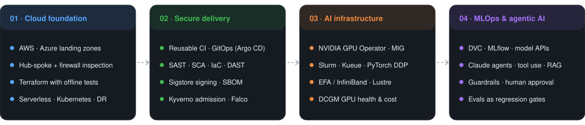
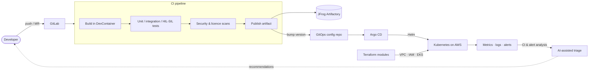

<!-- Profile README for github.com/santoshmyakala -->

<picture>
  <source media="(prefers-color-scheme: dark)" srcset="./assets/header-dark.svg">
  <source media="(prefers-color-scheme: light)" srcset="./assets/header-light.svg">
  
</picture>

 

  

<picture>
  <source media="(prefers-color-scheme: dark)" srcset="./assets/impact-dark.svg">
  <source media="(prefers-color-scheme: light)" srcset="./assets/impact-light.svg">
  
</picture>

---

## About

I design and build the platforms engineers ship on — **multi-account AWS and Azure foundations, Kubernetes with GitOps, large-scale CI/CD** (cloud, embedded and hardware-in-the-loop at Scania), and increasingly **GPU and AI infrastructure**. 15+ years in IT, 12 in DevOps and cloud, across Sweden, Belgium, France, Germany and India.

I work from architecture to production: ADRs, workshops, PoCs and technology evaluations, then hands-on delivery. My public repositories are built the same way — **every claim below is backed by code with passing CI**.

 

<picture>
  <source media="(prefers-color-scheme: dark)" srcset="./assets/capabilities-dark.svg">
  <source media="(prefers-color-scheme: light)" srcset="./assets/capabilities-light.svg">
  
</picture>

**Current focus:** AI-driven DevOps (agentic CI-failure triage, alert analysis), AI platform engineering and MLOps.

## Tech stack

<picture>
  <source media="(prefers-color-scheme: dark)" srcset="./assets/stack-dark.svg">
  <source media="(prefers-color-scheme: light)" srcset="./assets/stack-light.svg">
  
</picture>

## Featured projects

#### ☁️ Cloud & platform architecture

<table>
<tr>
<td colspan="2" valign="top">

### [cloud-solution-architectures](https://github.com/santoshmyakala/cloud-solution-architectures)
**AWS and Azure side by side**: landing-zone guardrails (SCPs / Azure Policy), hub-and-spoke inspection networking (Transit Gateway + Network Firewall / Azure Firewall Premium), serverless event-driven intake, Kubernetes platform and multi-region DR — with ADRs and Well-Architected mapping.

`Terraform` `AWS` `Azure` `Network Firewall` `Azure Policy` `Lambda` `Functions`

6 Terraform stacks with offline <code>terraform test</code> · blocking Trivy IaC gate · identical validation logic on both clouds

</td>
<td width="50%" valign="top">

### [aws-three-tier-platform](https://github.com/santoshmyakala/aws-three-tier-platform)
HA **web → app → MongoDB replica set** across three AZs with WireGuard VPN, least-privilege security groups and SSM-only access (no SSH).

`Terraform` `AWS` `ALB` `Auto Scaling` `MongoDB` `WireGuard`

5 plan-level tests with a mocked AWS provider · IMDSv2 · encrypted volumes

</td>
</tr>
<tr>
<td width="50%" valign="top">

### [ansible-elk-stack](https://github.com/santoshmyakala/ansible-elk-stack)
Secured **Elastic Stack 9**: auth on, least-privilege Logstash writer, Kibana only behind an Nginx TLS proxy, Vault-managed secrets.

`Ansible` `Elasticsearch` `Logstash` `Kibana` `Docker`

Deployed for real in CI · idempotent (changed=0) · end-to-end verify playbook

</td>
</tr>
</table>

#### 🔐 DevSecOps & software supply chain

<table>
<tr>
<td colspan="2" valign="top">

### [devsecops-gitops-pipeline](https://github.com/santoshmyakala/devsecops-gitops-pipeline)
Central **reusable secure-delivery workflow** (gitleaks → Semgrep → Trivy → SBOM → image gate → keyless Sigstore signing), signature-gated GitOps promotion, Argo CD, and **Kyverno 1.20** policies admitting only pipeline-signed images.

`GitHub Actions` `Sigstore` `Syft` `Trivy` `Argo CD` `Kyverno` `kind`

kind e2e: signed image admitted · unsigned, privileged, root and <code>:latest</code> denied

</td>
<td width="50%" valign="top">

### [devsecops-reference-architectures](https://github.com/santoshmyakala/devsecops-reference-architectures)
Eight DevSecOps architectures across platforms and lifecycle stages: GitHub, **GitLab**, **Azure DevOps** (Notation/Ratify), **AWS-native** (CodePipeline, Inspector, Signer), OPA/Conftest, **OWASP ZAP DAST**, External Secrets, **Falco**.

`GitLab CI` `Azure DevOps` `AWS Signer` `OPA` `ZAP` `Falco` `External Secrets`

19 Rego tests · schema-validated pipelines · live ZAP scan: 118 rules passed, 2 findings fixed at source

</td>
</tr>
</table>

#### 🧠 AI infrastructure & agentic AI

<table>
<tr>
<td width="50%" valign="top">

### [ai-infrastructure-hpc-gpu](https://github.com/santoshmyakala/ai-infrastructure-hpc-gpu)
**GPU training platform** on Kubernetes (GPU Operator, MIG/time-slicing, Kueue, PyTorchJob, DCGM alerts) and **Slurm HPC** (GRES, IB topology, Pyxis), on **EKS p5 + EFA + FSx Lustre** and **AKS ND H100 v5 + Managed Lustre**, plus an NVIDIA licensing guide.

`NVIDIA GPU Operator` `Slurm` `Kueue` `Kubeflow` `NCCL` `DCGM` `EFA` `Terraform`

Real 2-process DDP training in CI · real <code>slurmctld</code> accepts the config · PyTorchJob validated against Kubeflow CRD

</td>
<td width="50%" valign="top">

### [agentic-genai-platform](https://github.com/santoshmyakala/agentic-genai-platform)
**Ops Copilot**: a retrieval-grounded **Claude** agent for platform operations — runbook RAG with citations, live tools (DCGM, CI, model API), human-approved side effects, prompt-injection fencing and secret redaction, evals.

`Claude API` `Agents` `Tool use` `RAG` `FastAPI` `Prometheus`

31 deterministic tests with a scripted model client · 7-case behavioural eval set · ships via the signed pipeline

</td>
</tr>
</table>

#### 📈 MLOps & machine learning

<table>
<tr>
<td width="50%" valign="top">

### [wine-quality-mlops](https://github.com/santoshmyakala/wine-quality-mlops)
Reproducible ML lifecycle: **DVC → MLflow tracking & registry → FastAPI + Prometheus → hardened container → Helm**, delivered through the central DevSecOps pipeline.

`DVC` `MLflow` `scikit-learn` `FastAPI` `Helm` `Sigstore`

Test RMSE 0.598 vs 0.874 baseline · signed image promoted to dev

</td>
<td width="50%" valign="top">

### [wave-energy-farm-ml](https://github.com/santoshmyakala/wave-energy-farm-ml)
Wave-farm power from 16-buoy layouts at four sites: **gradient boosting vs MLP vs a permutation-equivariant set transformer**, with a data-leakage audit.

`PyTorch` `scikit-learn` `MLflow`

Set transformer R² 0.992 (Perth) · 27k duplicate rows found · blocked split exposes leakage

</td>
</tr>
<tr>
<td width="50%" valign="top">

### [fashion-mnist-neural-networks](https://github.com/santoshmyakala/fashion-mnist-neural-networks)
**Softmax regression → MLP → CNN** in PyTorch under one pipeline, so each architectural step is measured.

`PyTorch` `NumPy` `MLflow`

Test accuracy 84.1% → 90.6% → 93.5%

</td>
</tr>
</table>

### Live build status

Proof, not claims — every featured repository is tested on every push:

| Repository | CI |
|---|---|
| [cloud-solution-architectures](https://github.com/santoshmyakala/cloud-solution-architectures) |  |
| [devsecops-gitops-pipeline](https://github.com/santoshmyakala/devsecops-gitops-pipeline) |  |
| [devsecops-reference-architectures](https://github.com/santoshmyakala/devsecops-reference-architectures) |  |
| [ai-infrastructure-hpc-gpu](https://github.com/santoshmyakala/ai-infrastructure-hpc-gpu) |  |
| [agentic-genai-platform](https://github.com/santoshmyakala/agentic-genai-platform) |  |
| [wine-quality-mlops](https://github.com/santoshmyakala/wine-quality-mlops) |  |
| [aws-three-tier-platform](https://github.com/santoshmyakala/aws-three-tier-platform) |  |
| [ansible-elk-stack](https://github.com/santoshmyakala/ansible-elk-stack) |  |
| [wave-energy-farm-ml](https://github.com/santoshmyakala/wave-energy-farm-ml) |  |
| [fashion-mnist-neural-networks](https://github.com/santoshmyakala/fashion-mnist-neural-networks) |  |

Every project ships with CI, tests, results from real runs, SHA-pinned actions, secret scanning and Dependabot. Data sources are cited with their licences. The ML projects began as coursework from my PG Diploma in Machine Learning and were rebuilt as production-style reference implementations.

## Experience

**Scania (TRATON)** · **Play'n GO** · **ECARX / Volvo Cars** · **Hexagon** · Roller Gaming · ALTEN · Cyient

<b>Show roles and highlights</b>

| Period | Role | Organisation | Highlights |
|---|---|---|---|
| 2024 – present | DevOps Engineer, Driver System Software Factory | **Scania Group** (TRATON) | GitLab CI/CD and developer-platform architecture across cloud, Android, QNX, embedded and VM environments; automated HIL/SIL pipelines (build → deploy → flash → validate); targeted CI workflows improved by ~40–50%; standardised DevContainers; CI/platform observability with Datadog, OpenTelemetry, Prometheus/Grafana and Loki, plus Power BI CI reporting |
| 2023 – 2024 | Infrastructure Specialist | **Play'n GO** | AWS infrastructure with Terraform; networking, connectivity and SSL/TLS certificate lifecycle; Bitbucket delivery workflows |
| 2022 – 2023 | Cloud Engineer (consultant) | **ECARX Europe / Volvo Cars** via Explipro | AWS with Terraform (networking, IAM, compute, Kubernetes); GitOps with Argo CD; Helm charts; CI/CD traceability; GitLab/JFrog upgrades via GitOps; OAuth 2.0, MFA, Microsoft Entra ID; DevSecOps |
| 2017 – 2022 | Senior Product Development Engineer | **Hexagon Manufacturing Intelligence** | Enterprise CI/CD for multiple desktop and web products; led Perforce → GitLab migration |
| 2021 – 2022 | DevOps Engineer (remote) | **Roller Gaming UK** | AWS infrastructure automation with Terraform |
| 2012 – 2017 | Engineer → Senior Engineer | ALTEN · AMM Enterprise · Cyient · AXISCADES | GitLab CI/Jenkins pipelines, Azure deployments, Terraform, PostgreSQL data pipelines, automation |

Full history on <a href="https://www.linkedin.com/in/santoshkumar-myakala-b3456021/">LinkedIn</a>.

## Skills matrix

<b>Show the full skills matrix (Production · Projects · Exploring)</b>

> **Production** = used in the professional roles above. **Projects** = demonstrated in the public repositories below. **Exploring** = currently learning.

<table>
<tr><th align="left" width="18%">Area</th><th align="left">Production</th><th align="left" width="26%">Projects</th><th align="left" width="16%">Exploring</th></tr>
<tr>
<td><b>Cloud platforms</b></td>
<td>AWS (multi-account, VPC & networking, IAM, compute, storage) · Microsoft Azure · Microsoft Entra ID · Cloud networking · SSL/TLS</td>
<td>Multi-AZ VPC design · WireGuard VPN · SSM-only access</td>
<td>Google Cloud · Hybrid cloud</td>
</tr>
<tr>
<td><b>DevOps & platform</b></td>
<td>GitLab CI/CD · Jenkins · GitHub Actions · Bitbucket · Docker · DevContainers · Kubernetes · Helm · Argo CD / GitOps · Terraform · Ansible · JFrog Artifactory · Python · Bash · C · C++ · Groovy (Jenkins pipelines) · Java · JavaScript · Go · Rust · Linux (Red Hat, SUSE, Ubuntu, Debian, Kali) · QNX</td>
<td>Reusable workflows · Argo CD app-of-apps · <code>terraform test</code> with mocked providers</td>
<td>Internal developer platforms</td>
</tr>
<tr>
<td><b>Observability & reliability</b></td>
<td>SRE practices · Datadog · OpenTelemetry · Prometheus · Grafana · Loki · ELK stack · Power BI CI reporting · Monitoring & alerting</td>
<td>Elastic Stack 9 · Prometheus metrics in services · DCGM GPU alerts</td>
<td>LLM observability</td>
</tr>
<tr>
<td><b>Security</b></td>
<td>DevSecOps · IAM · OAuth 2.0 · MFA · Access control in CI/CD</td>
<td>Sigstore keyless signing · SBOM attestation · Kyverno (CEL) admission · Trivy · Semgrep · gitleaks</td>
<td>SLSA provenance</td>
</tr>
<tr>
<td><b>Architecture</b></td>
<td>CI/CD design · Build & release systems · Infrastructure architecture · ADRs, PoCs & technology evaluation · Cloud migration & legacy modernisation</td>
<td>Threat modelling (STRIDE) · signature-gated promotion</td>
<td>Bazel · Large-scale distributed systems</td>
</tr>
<tr>
<td><b>Data engineering</b></td>
<td>Data pipelines · Kafka · Airflow · NiFi · dbt · Databricks · Hadoop · Hive · Spark · PostgreSQL · MySQL · Redis · pandas · NumPy</td>
<td>DVC data pipelines · DynamoDB / Cosmos DB designs · MongoDB replica set · data-quality audits (pandas)</td>
<td>—</td>
</tr>
<tr>
<td><b>MLOps & AI infrastructure</b></td>
<td>AI-assisted CI log / failure triage (AIOps)</td>
<td>MLflow · DVC · FastAPI model serving · Helm · PyTorch DDP · NVIDIA GPU Operator · Slurm · Kueue · Claude API agents (tool use, RAG, evals)</td>
<td>Model / drift monitoring · LLM observability</td>
</tr>
</table>

## How I typically build platforms

A generalised view of the delivery platforms I have designed — not a specific employer's system.

## Certifications & education

Software Architecture of Large-Scale Systems · Cloud Security Lead & Cloud Leader AWS (Scania) · AWS VPC & Networking · Google SRE Culture · IIT Roorkee Big Data Engineering · IBM Big Data & ML

<b>Show all certifications and education</b>

<table>
<tr><td valign="top" width="50%">

**Cloud, architecture & reliability**
- Software Architecture & Technology of Large-Scale Systems — NewTechWays (2025)
- Cloud Security Lead — Scania Group (2024)
- Cloud Leader AWS — Scania Group (2024)
- AWS VPC and Networking in Depth — Udemy (2023)
- DevOps Specialization — CloudxLab (2022)
- Developing a Google SRE Culture — Coursera / Google Cloud (2021)
- Google Cloud Platform Fundamentals: Core Infrastructure — Coursera (2021)

</td><td valign="top" width="50%">

**Data & machine learning**
- Big Data Engineering with Hadoop & Spark — EICT, IIT Roorkee (2019)
- Big Data & Machine Learning Professional Degree — IBM (2019)
- Data Science Professional Degree — NSDC (2019)
- Deploying Scalable Machine Learning for Data Science — LinkedIn Learning (2021)
- Machine Learning with Python — IBM / Cognitive Class (2021)

**Education**
- Master of Computer Applications — Andhra University
- B.Tech, Aeronautical Engineering — JNTU (university top-5 rank)

</td></tr>
</table>

## GitHub activity

<picture>
  <source media="(prefers-color-scheme: dark)" srcset="https://raw.githubusercontent.com/santoshmyakala/santoshmyakala/output/snake-dark.svg">
  <source media="(prefers-color-scheme: light)" srcset="https://raw.githubusercontent.com/santoshmyakala/santoshmyakala/output/snake.svg">
  
</picture>
 
<picture>
  <source media="(prefers-color-scheme: dark)" srcset="https://github-readme-stats.vercel.app/api?username=santoshmyakala&show_icons=true&hide_border=true&theme=github_dark">
  
</picture>
<picture>
  <source media="(prefers-color-scheme: dark)" srcset="https://streak-stats.demolab.com?user=santoshmyakala&hide_border=true&theme=github-dark-blue">
  
</picture>

---

Open to conversations about platform engineering, AI infrastructure and cloud architecture — reach out on <a href="https://www.linkedin.com/in/santoshkumar-myakala-b3456021/">LinkedIn</a>.

